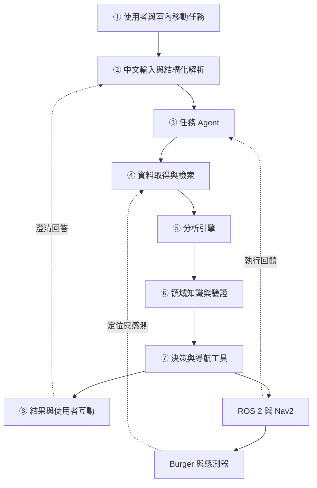
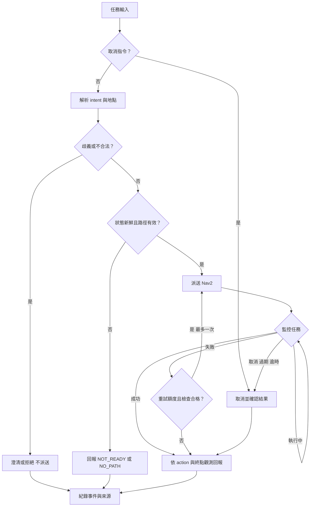

# 系統設計文件

DIC3（2026-11-12）：本文件保留系統設計脈絡；轉換後的 OpenSpec [設計與章節對照](openspec/changes/refactor-tb3-proposal/design.md)、[需求與情境](openspec/changes/refactor-tb3-proposal/specs/navigation-mission/spec.md)、[任務清單](openspec/changes/refactor-tb3-proposal/tasks.md) 及 [操作說明](docs/DIC3_OPENSPEC.md) 為本次新增。現有離線行為見 openspec/specs/offline-contract；完整導航仍待實作。

## 1 問題與需求

以 TurtleBot3 Burger 為平台之室內導航與任務決策 AI Agent。任務層需要處理語意歧義、未知地點、狀態異常與結果回報。
導航層使用既有 Nav2，不宣稱新增路徑演算法。

功能需求：解析中文、列出命名地點、澄清、查狀態、檢查路徑、派送／取消、監控及證據回報。
非功能需求：單一活動任務、有限重試、工具參數驗證、回報可追溯、模擬與實機結果分離。

## 2 Architecture



①使用者提出室內移動任務；②輸入層將中文轉結構化意圖；③Agent 管理任務與工具順序；
④資料層讀地點、規則、感測與 action；⑤分析層計算時效、進度與實驗指標；
⑥驗證層檢查權限與領域限制；⑦工具層派送導航或取消；⑧互動層依觀察結果回報。

## 3 Components 與 Implementation Mapping

| 模組 | 預計檔案 | 目前狀態 |
|---|---|---|
| 任務解析與模型輸出 | src/intent_parser.py | 待實作；離線範例僅讀 JSON |
| 知識與地點檢索 | config/landmarks.json、docs/domain_rules.md | 有示範資料與領域規則 |
| 任務驗證 | src/agent_demo.py 中 validate_request | 已實作離線白名單與 schema 驗證 |
| 狀態與任務管理 | src/mission_manager.py | 待實作；離線範例使用情境分支 |
| ROS／Nav2 adapter | src/nav2_adapter.py | 待實作；介面見 INTERFACES.md |
| 事件紀錄 | src/agent_demo.py 的 JSON 輸出 | 已有離線示範；正式 JSONL logger 待整合 |
| 評估 | docs/EXPERIMENTS.md、data/results_template.csv | 已設計；尚無實驗結果 |

## 4 Data Flow

中文輸入 → LLM 結構化 intent → 地點 ID／規則檢索 → schema／權限檢查 → 新鮮狀態摘要 →
路徑可行性 → 導航目標 → feedback／終止結果 → 事件紀錄 → 使用者回報。
命名地點轉座標由 registry 執行，不能使用模型生成的任意座標。

## 5 AI Model

初版使用既有可結構化輸出的 LLM，不自行訓練。模型供應者與 ID 尚未固定；正式實驗前需記錄
完整 model_id、版本日期、temperature、prompt_hash、輸入／輸出與請求延遲。
若模型失敗、逾時或輸出不合格，傳回明確錯誤或澄清，不默默改成猜測導航。
檢索先用 JSON 地點索引與規則關鍵字，不需要向量資料庫。
可記錄簡短決策理由與來源，不要求模型公開內部思考過程。

## 6 Domain Knowledge

參閱 domain_rules.md。核心是定位不確定性、2D 感測限制、車身範圍、導航分層及可重現評估。
footprint、速度、感測 timeout 等設定須依實機與實驗核對；沒有一組參數能保證所有環境安全。
LLM 不能修改底層安全設定；低延遲停止獨立於雲端模型。

## 7 Flowchart



## 8 Algorithm

```text
Algorithm 1  Evidence grounded indoor navigation agent
Input: query Q, landmark registry K, robot status S
Output: mission result R with evidence E
01: if Q is an explicit cancel command: cancel active goal; return status
02: reject a new movement request while another mission is active
03: read K and retrieve relevant domain rules with source IDs
04: parse Q into a schema constrained intent using the LLM
05: if parsing fails or the service times out: return clarification/error
06: if intent is ambiguous: ask user; return CLARIFY
07: validate tool name, landmark ID and schema against allowlists
08: if validation fails: return REJECTED without sending a goal
09: read scan, localization, TF and navigation lifecycle status
10: if data are stale or checks fail: return NOT_READY with evidence
11: resolve landmark ID into a registered pose in the map frame
12: request a path feasibility check with a bounded timeout
13: if no valid path: return NO_PATH; do not claim the goal is reached
14: send the validated goal through the navigation adapter
15: while mission deadline has not expired:
16:     read navigation feedback and fresh status; append evidence
17:     if user cancels or status is unsafe/stale:
18:         cancel goal; verify response; return CANCELED only if cancellation and stopping are confirmed, otherwise FAULT
19:     if navigation result is SUCCEEDED:
20:         return ARRIVED if fresh final pose meets tolerances, else FAULT
21:     if navigation result is FAILED or CANCELED:
22:         if FAILED and retry budget remains and fresh checks pass:
23:             recheck path; retry once only when a valid path exists
24:         else: return the observed terminal result with evidence
25: cancel goal; verify cancellation or escalate unresolved state
26: return TIMEOUT with log IDs; never substitute an LLM guess
```

「最多一次」指 Nav2 自己的行為樹恢復已終止後，Agent 最多再派送一次；不是無限疊加恢復。
取消優先於新任務。未收到終止或停止確認時回報未確認，不能聲稱已停止；未確認狀態阻擋新移動任務。任務逾時仍回報 TIMEOUT，附上終止／停止確認資訊。

## 9 Interfaces

詳見 docs/INTERFACES.md。正常導航輸入只有 intent 和 landmark_id；額外欄位、未知地點與未知工具拒絕。
工具結果需含 timestamp、frame_id／map_id、status、error_code、evidence_id。
API 與 topic 使用前依已安裝發行版驗證；參考文件可能描述較新版本。

## 10 Installation 與 How to Run

README.md 提供無依賴 Python 離線範例及 Dockerfile。
ROS／Nav2／Gazebo 的正式整合與啟動流程尚未完成；現有離線範例不控制實機。

## 11 Results

目前沒有 LLM、模擬導航或實機評估結果。隨附單元測試只檢查離線任務驗證與狀態分支，
不能作為導航成功率或 LLM 準確率。正式評估依 EXPERIMENTS.md 執行並保留原始紀錄。

## 12 Limitations 與後續

只處理登錄地點；對相似地點先澄清。僅單車室內 2D 地圖，不含視覺物件辨識、抓取或 RL 訓練。
通訊失效、定位誤差、雷射盲區與服務延遲均可能影響任務。後續再考慮動態障礙、
多目標任務與長期地圖維護。期末依實際完成範圍更新本文件與實驗結果。
