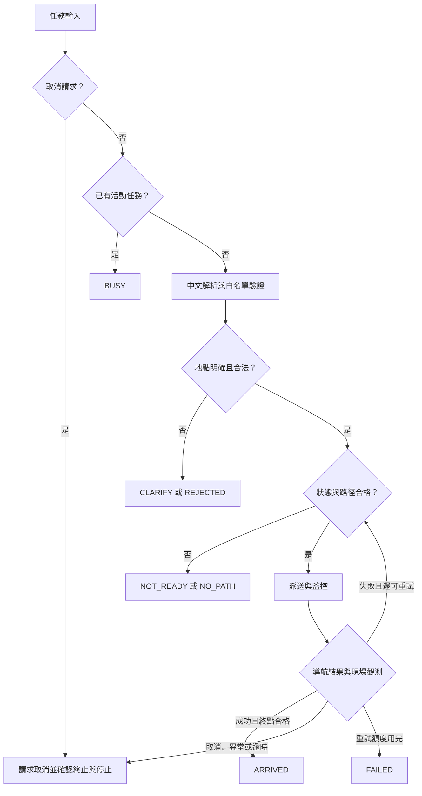

# Technical Design

## Context

根目錄 DESIGN.md 已定義八模組、工具白名單、單任務與有限重試。現有程式只驗證 JSON 並回傳 mock 分支，沒有中文解析或 ROS 連線。本變更將敘述轉成可核對的系統規格，並重寫提案；規格存在不代表 runtime 已完成。

## Goals / Non-Goals

目標：提案 A–F、緒論與相關研究可追溯；將未來導航行為與驗收情境對應；保留可執行離線基準。

範圍：單車、單一室內地圖、人工命名地點。不新增 RL、物件辨識、抓取、多車或任意座標控制。本次不修改 src、tests 與底層導航。

## Decisions

1. **分開既有與待實作規格。** openspec/specs/offline-contract 記錄現有行為；本 change 的 navigation-mission 與 mission-evaluation 保留為提案。正式整合與驗收前不 archive 成已完成基準。
2. **語意與控制分層。** LLM 輸出受限 intent；gateway 依地點表轉 PoseStamped；Nav2 負責導航。以 schema／白名單限制工具，底層停止不依賴模型。
3. **單一任務擁有權。** mission manager 記錄 mission_id、goal_id、registry_version、map_id、attempt、deadline 與 state。未確認終止前不釋放擁有權；取消優先。
4. **每次派送重新檢查。** 澄清後、重試前、送目標前都核對地圖及新鮮狀態。路徑有效僅是派送條件，不是未來無碰撞保證。
5. **終點與停止有各自證據。** ARRIVED 須 action 成功且 final pose 在位置／朝向容許範圍；CANCELED 須 action 取消且停止觀察合格。取消失聯回 FAULT；任務超時回 TIMEOUT 並附停止是否確認，保留 unresolved 狀態。
6. **固定比較條件。** B0/B1/B2 共用 Nav2，評估 Agent 行為增益；以 60 筆中文與既有導航情境規畫分層評估，不沿用文獻數字當成本組成果。

## Runtime Workflow

圖中重試只允許一次，且舊 action 已終止。X 依觸發原因回傳 CANCELED、FAULT 或 TIMEOUT，不能直接改成 ARRIVED。CLARIFY 的回答要重新進入驗證與狀態檢查。

## Parameters To Freeze Before Integration

| 類別 | 必須記錄的設定 | 目前狀態 |
|---|---|---|
| 平台 | ROS 發行版、Nav2／Gazebo 版本、實機 LDS 與 footprint | 待依機器確認 |
| 時效 | scan／pose 最大資料年齡、TF 查詢期限 | 待實測決定 |
| 截止 | 模型、路徑、mission、取消確認 timeout | 待實測決定 |
| 終點 | 位置與朝向容許值、final pose 時效 | 待與 Nav2 設定核對 |
| 停止 | 線／角速度門檻、連續觀察時間與資料時效 | 待實測決定 |
| 模型 | 完整 model_id、版本、temperature、prompt hash | 待選定 |

使用 ROS 時間計算感測年齡，使用單調計時器處理控制 deadline；模擬與實機設定分開。沒有完成上述設定，不可宣稱整合驗收已通過。

## Traceability From DESIGN.md

| 原章節 | OpenSpec／文件 | 驗收方式 |
|---|---|---|
| 1 問題與需求 | proposal.md、PROPOSAL.md 第 1–3 節 | 範圍、研究問題與貢獻核對 |
| 2–4 架構與資料流 | 本 design 的 Decisions／Workflow | 人工流程審閱 |
| 5–6 AI／領域知識 | navigation-mission 前五項需求 | 未知地點、歧義、模型逾時與故障注入 |
| 7–8 流程與演算法 | navigation-mission 監控／重試／終止需求 | 任務狀態整合測試，待實作 |
| 9 工具介面 | docs/INTERFACES.md | adapter 契約測試，待實作 |
| 10 安裝與執行 | README.md、docs/DIC3_OPENSPEC.md | CLI 與原本單元測試 |
| 11–12 結果與限制 | mission-evaluation、docs/EXPERIMENTS.md | 固定資料／模擬／實機評估，待執行 |

## Risks / Trade-offs

澄清與檢查增加延遲，但可阻擋不合法派送；預建地圖降低語意定位範圍，但需維護地點表；Nav2 分層便於定位錯誤，但不能代表 Agent 能改善底層路徑品質。用配對場景與兩項消融分別量測，不先宣稱勝出。

## Migration Plan

先提交 DIC3 規格與文件，再實作 parser／manager／adapter 與 logger。完成各條整合驗收後才勾選 tasks 的 runtime 項目並 archive。既有 PDF／PPTX 是期中快照，新版 DIC3 文字以 PROPOSAL.md 為準。

## Open Questions

正式模型、平台版本、時效門檻、終點／停止容許值待整合前確認。iLearning 上傳格式仍依教師公告；本頁面只明列工作內容，未要求一定重製期中 PDF／PPTX。
